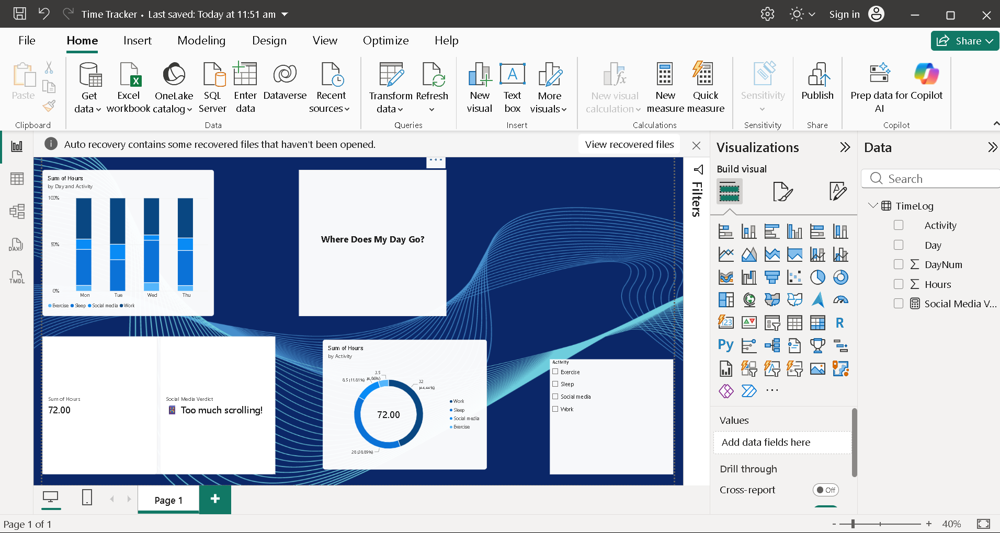

# Where Does My Day Go? – Power BI Time Tracker

A simple personal time-tracking report built in Power BI.

## Features
- Donut chart showing time split by activity
- Stacked columns showing each day's mix
- Slicer to filter by activity
- DAX measure that gives a "Social Media Verdict"

## How to use
Download `Time Tracker.pbix` and open it in Power BI Desktop (free).
